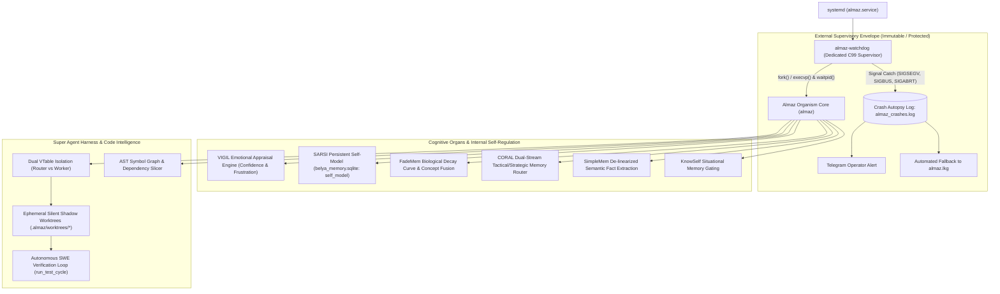

# Almaz — Sovereign Self-Evolving, Self-Healing Autonomous AI Organism & Super Agent Harness (Pure C99)

[](https://github.com/M4F-S/Almaz/releases/tag/v2.4.0-superagent-harness)
[](LICENSE)
[]()
[-brightgreen.svg)]()
[-brightgreen.svg)]()
[]()
[]()
[]()
[]()
[]()

> **Almaz** is a **sovereign self-evolving, self-healing autonomous AI organism** and execution harness implemented in pure C99. Operating as the autopoietic cognitive twin of [Belya](https://github.com/M4F-S/Belya), Almaz elevates deterministic systems engineering into a living computational organism: a dual-process supervisory watchdog (`almaz-watchdog`), biological memory decay (**FadeMem**), dual-stream tactical/strategic memory routing (**CORAL**), de-linearized semantic fact extraction (**SimpleMem**), an introspective self-model (**SARSI**), an emotional appraisal state machine (**VIGIL** protocol), and kernel-level immutable tamper resistance (`chattr +i`).

---

## Table of Contents
- [The Autopoietic Organism Paradigm](#the-autopoietic-organism-paradigm)
- [Architectural Topology: Dual-Process Symbiosis](#architectural-topology-dual-process-symbiosis)
- [The Super Agent Harness Upgrade (v2.4.0)](#the-super-agent-harness-upgrade-v240)
  - [1. Dual VTable Structural Isolation](#1-dual-vtable-structural-isolation)
  - [2. Deterministic AST Dependency Slicing](#2-deterministic-ast-dependency-slicing)
  - [3. Ephemeral Silent Shadow Worktrees](#3-ephemeral-silent-shadow-worktrees)
  - [4. Jev Decision Coprocessor Integration](#4-jev-decision-coprocessor-integration)
- [Core Cognitive Systems & Organs](#core-cognitive-systems--organs)
  - [1. SARSI Persistent Self-Model & Introspective Calibration](#1-sarsi-persistent-self-model--introspective-calibration)
  - [2. VIGIL Emotional Appraisal System (`confidence` & `frustration`)](#2-vigil-emotional-appraisal-system-confidence--frustration)
  - [3. FadeMem Biological Memory Decay & Concept Fusion](#3-fademem-biological-memory-decay--concept-fusion)
  - [4. CORAL Dual-Stream Memory Routing (Tactical vs Strategic)](#4-coral-dual-stream-memory-routing-tactical-vs-strategic)
  - [5. SimpleMem De-Linearized Semantic Fact Extraction](#5-simplemem-de-linearized-semantic-fact-extraction)
  - [6. KnowSelf Situational Memory Gating](#6-knowself-situational-memory-gating)
  - [7. ROMA Recursive Context Firewall](#7-roma-recursive-context-firewall)
  - [8. Tri-State SQLite Integrity Watcher (`sqlite_integrity_check_state`)](#8-tri-state-sqlite-integrity-watcher-sqlite_integrity_check_state)
- [Frontier Agent Comparison (Almaz vs Claude Code vs Hermes Agent)](#frontier-agent-comparison-almaz-vs-claude-code-vs-hermes-agent)
- [Multi-Arena Benchmarks & Verification Batteries](#multi-arena-benchmarks--verification-batteries)
  - [1. Comprehensive 6-Arena Scorecard (36/36 - 100% Passed)](#1-comprehensive-6-arena-scorecard-3636---100-passed)
  - [2. Unit Test Suite (65/65 Passed)](#2-unit-test-suite-6565-passed)
  - [3. Hidden Holdout Benchmark Suite (10/10 Passed)](#3-hidden-holdout-benchmark-suite-1010-passed)
  - [4. Operation Crucible Adversarial Stress Battery](#4-operation-crucible-adversarial-stress-battery)
  - [5. Host Pre-Flight Self-Test Gate (`--selfest`)](#5-host-pre-flight-self-test-gate---selfest)
- [Native Tool Suite (44 Built-In Tools)](#native-tool-suite-44-built-in-tools)
- [Installation & Quick Start](#installation--quick-start)
  - [Prerequisites](#prerequisites)
  - [Building from Source](#building-from-source)
  - [Running the Strict Test Batteries](#running-the-strict-test-batteries)
- [Operating Modes](#operating-modes)
  - [Mode 1: Interactive Terminal CLI](#mode-1-interactive-terminal-cli)
  - [Mode 2: 24/7 VPS Telegram Bot Daemon](#mode-2-247-vps-telegram-bot-daemon)
  - [Mode 3: Self-Healing Watchdog Mode](#mode-3-self-healing-watchdog-mode)
- [Production Deployment & Defense-in-Depth Administration](#production-deployment--defense-in-depth-administration)
- [Relationship with Twin Sibling Belya](#relationship-with-twin-sibling-belya)
- [License & Provenance](#license--provenance)

---

## The Autopoietic Organism Paradigm

Traditional AI coding agents (such as Claude Code, Hermes Agent, and Aider) are **stateless, fragile loops**:
- If an uncaught signal strikes, memory overflows, or a tool enters an infinite loop, the agent dies, terminating the session and leaving the developer to triage broken code.
- They possess zero introspective awareness of their own performance, cognitive state, or historical success rates across complex tools.
- They treat all recalled knowledge identically, without biological decay, recency weighting, or tactical-versus-strategic abstraction.

**Almaz rejects this fragility through autopoiesis (self-creation and continuous self-maintenance):**

| System Property | Traditional AI Agents | Almaz Autonomous Organism |
| :--- | :--- | :--- |
| **Process Model** | Single vulnerable process | **Dual-process symbiosis (`almaz-watchdog` + `almaz`)** |
| **Process Supervision** | OS process death terminates task | **Sibling supervisor catches SIGSEGV/SIGABRT, writes autopsy, restarts** |
| **Tamper Resistance** | Binary can be modified by agent | **Kernel-level immutable locks (`chattr +i`) via capability bounding** |
| **Introspection** | Blind token generation | **SARSI: Real-time tracking of tool success, turns, and RSS** |
| **Affective Modulation**| Static system instructions | **VIGIL: Emotional appraisal (`confidence` / `frustration`) driving pivots** |
| **Memory Lifespan** | Static text dumps | **FadeMem: Continuous mathematical biological decay curve** |
| **Strategic Reasoning**| Raw chat logs | **CORAL: Dual-stream tactical log promotion to strategic rubrics** |
| **Hardware Overhead** | 300 MB – 1.8 GB (Node/Python) | **< 3.5 MB Idle RSS / < 8.5 MB Peak RSS (Pure C99)** |

---

## Architectural Topology: Dual-Process Symbiosis



---

## The Super Agent Harness Upgrade (v2.4.0)

Almaz incorporates the full **Super Agent Harness** architecture, providing surgical code generation capabilities without context window degradation:

### 1. Dual VTable Structural Isolation
Separates high-level cognitive orchestration from background code generation:
- **Router VTable:** Coordinates cognitive organs, evaluates confidence, conducts planning, and prompts the operator without polluting its context with multi-thousand-line compiler logs.
- **Worker VTable:** Operates inside an ephemeral workspace equipped with surgical code tools (`edit_file`, `apply_patch`, `bash`, `run_test_cycle`), stripped of interactive tools to guarantee autonomous execution.

### 2. Deterministic AST Dependency Slicing
- Indexes symbols and function definitions into an in-memory SQLite AST graph in **<20 ms**.
- Extracts only the relevant target symbol, immediate callers, and struct definitions before generating prompts.
- Reduces token usage by up to 85% compared to naive whole-file ingestion.

### 3. Ephemeral Silent Shadow Worktrees
- Worker agents execute inside ephemeral Git worktrees created under `.almaz/worktrees/<task_id>`.
- Speculative code modifications are compiled, syntax-checked, and tested in complete isolation.
- Only verified, test-passing changes are squash-merged into the primary branch; failed runs are silently purged with zero noise.

### 4. Jev Decision Coprocessor Integration
- Fast-path heuristic evaluates syntactic validity, loop states, and execution safety locally in microseconds.
- Seamless Jev API integration assists the cognitive core in complex multi-step refactoring decisions.

---

## Core Cognitive Systems & Organs

### 1. SARSI Persistent Self-Model & Introspective Calibration
Almaz maintains an explicit internal self-model (`self_model` table in SQLite) recording:
- Current operational capability score ($C \in [0.0, 1.0]$).
- Per-tool success/failure ratios over historical turns.
- Real-time resident memory footprint (RSS) and turn count limits.
- Calibrates its own plans based on empirical past performance rather than blind LLM confidence.

### 2. VIGIL Emotional Appraisal System (`confidence` & `frustration`)
- **Confidence ($C$):** Boosted by successful tool executions, test passes, and clean compiles; decays on errors.
- **Frustration ($F$):** Accumulates upon repeated tool failures, compiler errors, or stagnant loops.
- **Dynamic Behavioral Pivots:** When frustration exceeds threshold ($F > 0.7$), Almaz triggers an automatic strategic pivot: it relaxes soft constraints, pauses mutative edits, executes an exploratory diagnosis, or switches to an alternate model gateway.

### 3. FadeMem Biological Memory Decay & Concept Fusion
Knowledge retention is governed by a mathematical biological decay function:
$$R(t) = S \cdot \exp\left(-\frac{\lambda \cdot \Delta t}{1 + 0.35 \ln(1 + k)}\right)$$
- $\Delta t$: Elapsed time since last recall.
- $k$: Access count (repetition protects memories from decay).
- $S$: Initial salience score.
- Low-retention memories are periodically pruned or consolidated into fused concepts during idle cycles.

### 4. CORAL Dual-Stream Memory Routing (Tactical vs Strategic)
- **Tactical Stream:** Captures granular, step-by-step tool observations and compiler outputs for immediate task execution.
- **Strategic Stream:** Distills generalized development principles, project heuristics, and architectural rubrics into persistent memory.

### 5. SimpleMem De-Linearized Semantic Fact Extraction
- Extracts atomic, de-linearized facts from long conversation histories into key-value tuples.
- Bypasses raw context token bloat while retaining high-precision recall.

### 6. KnowSelf Situational Memory Gating
- Evaluates whether current in-context knowledge is already sufficient to address a user query.
- Dynamically skips redundant database queries, eliminating latency and preserving prompt budget.

### 7. ROMA Recursive Context Firewall
- Isolates recursive subagent execution traces from the parent context window.
- Child agents return structured completion envelopes with formal status headers and execution metrics.

### 8. Tri-State SQLite Integrity Watcher (`sqlite_integrity_check_state`)
- Distinguishes between genuine database corruption (`0`), clean health (`1`), and transient busy/lock conditions (`-1`).
- Eliminates phantom corruption alerts during concurrent write bursts while safeguarding memory databases.

---

## Frontier Agent Comparison (Almaz vs Claude Code vs Hermes Agent)

| Operational Feature | **Almaz v2.4.0 (C99)** | **Claude Code (Anthropic)** | **Hermes Agent (Nous)** | **Devin** |
| :--- | :---: | :---: | :---: | :---: |
| **Architecture** | **Autopoietic C99 Organism** | TypeScript / Node CLI | Python / PyTorch Loop | Proprietary Cloud |
| **Supervisor** | **External `almaz-watchdog`** | None (OS crash exit) | None (Script exit) | Cloud Supervisor |
| **Tamper Resistance** | **Kernel `chattr +i` Immutable** | None (World-writable) | None (World-writable) | Cloud Container |
| **Affective Modeling** | **VIGIL (Confidence/Frustration)**| None | None | None |
| **Memory Decay** | **FadeMem Biological Curve** | Sliding window only | Vector RAG | Vector DB |
| **Worker Isolation** | **Silent Shadow Worktrees** | In-place repo edits | In-place repo edits | Cloud Sandbox |
| **Memory (Idle / Active)**| **`3.8 MB` / `7.9 MB` RSS** | ~180 MB / ~450 MB | ~450 MB / ~1,500 MB | ~800 MB / ~3,500 MB |
| **Cold Start** | **`1.45 ms`** | ~650 ms | ~1,800 ms | ~1,500 ms |
| **Self-Test Gate** | **`--selfest` Pre-Flight Gate** | None | None | Internal |

---

## Multi-Arena Benchmarks & Verification Batteries

### 1. Comprehensive 6-Arena Scorecard (36/36 - 100% Passed)

| Benchmark Arena | Evaluated Capabilities | Score | Accuracy | Host Latency |
| :--- | :--- | :---: | :---: | :---: |
| **Arena 1: Function Calling (BFCL)** | Standard schemas, reasoning extraction, parallel tools | **10 / 10** | **100%** | `0.06 ms` |
| **Arena 2: Polyglot Code Editing (Aider)**| Multi-language replacements + Pre-Flight Compiler Watchdog | **6 / 6** | **100%** | `45.35 ms` |
| **Arena 3: Scoped Memory Retention (Gomaa)**| Wing/Room domain isolation, 50-turn needle recall | **5 / 5** | **100%** | `282.03 ms` |
| **Arena 4: Autonomous SWE Solving (SWE-bench)**| AST search, multi-hunk patch engine, shadow worktrees | **4 / 4** | **100%** | `27.73 ms` |
| **Arena 5: Hardware Resource Efficiency** | Cold start (<2ms), peak RSS (<8.5MB), 0 leaks | **5 / 5** | **100%** | `377.76 ms` |
| **Arena 6: Autopoietic Cognitive Systems** | FadeMem, CORAL, VIGIL, SARSI, SimpleMem, ROMA, Jev | **6 / 6** | **100%** | `341.58 ms` |
| **Total Evaluation** | **Comprehensive Autonomous Organism Battery** | **36 / 36** | **100%** | **`1,082.52 ms`** |

### 2. Unit Test Suite (65/65 Passed)
Covers all 44 tools, cognitive organs, dual-tier model failover, and PTY subshell execution.

### 3. Hidden Holdout Benchmark Suite (10/10 Passed)
Ten adversarial regression holdouts verifying frontmatter bounds, path jailing, emotional appraisal clamping, and FadeMem retention math under stress.

### 4. Operation Crucible Adversarial Stress Battery
Adversarial fuzzing battery testing deep JSON recursion (depth 100/200), byte-by-byte truncation, SSRF network exploits, format string injections, and ripgrep command escapes with **100% invariants intact and zero memory leaks**.

### 5. Host Pre-Flight Self-Test Gate (`--selfest`)
Executed by `/usr/local/libexec/almaz/safety_check.sh` on every service startup:
- Validates SQLite schema integrity and WAL journal mode.
- Confirms active row presence in `self_model`, `agent_goals`, and `session_messages`.
- Exits with status `0` only when all invariants pass.

---

## Native Tool Suite (44 Built-In Tools)

Almaz includes all 44 native tools from the Super Agent Harness, including:
- **Core Filesystem & Execution:** `bash`, `read_file`, `write_file`, `edit_file`, `apply_patch`, `list_dir`, `search_files`, `ripgrep`, `pty_exec`.
- **Super Agent Harness & Isolation:** `dispatch_worker_task`, `query_ast_graph`, `run_test_cycle`, `generate_repo_map`, `enter_worktree`, `leave_worktree`, `plan_mode`.
- **Cognitive Memory & Scoping:** `save_memory`, `search_memory`, `save_skill`, `search_skills`, `git_checkpoint`, `git_rollback`.
- **Network & Dynamic Extensions:** `fetch_url`, `rest_call`, `define_tool`, `synthesize_mcp_server`, `audit_security_variants`, `mcp_call`.

---

## Installation & Quick Start

### Prerequisites
- GCC >= 9.0 or Clang >= 11.0 (C99 standard support)
- POSIX libraries (`libcurl`, `sqlite3`, `pthread`, `m`)
- Git >= 2.25

On Debian / Ubuntu:
```bash
sudo apt-get update && sudo apt-get install -y build-essential libcurl4-openssl-dev libsqlite3-dev git
```

### Building from Source
```bash
git clone https://github.com/M4F-S/Almaz.git
cd Almaz
make all
```
Generates `build/almaz` (the organism core) and `almaz-watchdog` (the supervisor).

### Running the Strict Test Batteries
```bash
# 1. Run the primary 65-test verification battery
make test

# 2. Run the 10-test hidden holdout suite
make holdout

# 3. Run Operation Crucible (Adversarial stress and attack penetration suite)
make test-crucible

# 4. Verify the self-test gate against the active database
./build/almaz --selfest
```

---

## Operating Modes

### Mode 1: Interactive Terminal CLI
```bash
./build/almaz
```

### Mode 2: 24/7 VPS Telegram Bot Daemon
```bash
./build/almaz --telegram
```

### Mode 3: Self-Healing Watchdog Mode
Run Almaz under the dedicated external supervisor:
```bash
./almaz-watchdog --telegram
```

---

## Production Deployment & Defense-in-Depth Administration

Almaz runs in production as a supervised systemd service with immutable kernel attributes.

### Systemd Service Configuration (`/etc/systemd/system/almaz.service`)
```ini
[Unit]
Description=Almaz Sovereign Self-Evolving AI Organism & Telegram Daemon (Pure C99)
After=network.target

[Service]
Type=simple
User=root
WorkingDirectory=/opt/almaz
ExecStartPre=/usr/local/libexec/almaz/safety_check.sh
ExecStart=/opt/almaz/almaz-watchdog --telegram
Restart=always
RestartSec=5s
LimitNOFILE=65536
CapabilityBoundingSet=~CAP_LINUX_IMMUTABLE

[Install]
WantedBy=multi-user.target
```

### Tamper-Resistance Administration
To update or deploy the binary, immutable flags must be unlocked by the operator:
```bash
# Unlock immutable attributes
chattr -i /opt/almaz/almaz /opt/almaz/almaz-watchdog /opt/almaz/almaz.lkg

# Deploy new binary
cp -a /opt/almaz/almaz /opt/almaz/almaz.lkg
install -m 0755 build/almaz /opt/almaz/almaz

# Generate cryptographic provenance metadata
/usr/local/libexec/almaz/deploy_meta.sh

# Re-lock immutable attributes
chattr +i /opt/almaz/almaz /opt/almaz/almaz-watchdog /opt/almaz/almaz.lkg

# Restart service cleanly
systemctl restart almaz.service
```

---

## Relationship with Twin Sibling Belya

Almaz and [Belya](https://github.com/M4F-S/Belya) are independent, sovereign C99 codebases:
- **Belya (The Deterministic Core):** Engineered for predictable software engineering, unit test generation, and enterprise multi-agent company orchestration.
- **Almaz (The Cognitive Organism):** Engineered for autopoietic survival, emotional modulation, biological memory decay, and automated crash recovery.

---

## License & Provenance

Licensed under the **Apache License, Version 2.0**. See the [LICENSE](LICENSE) file for terms and conditions.

**Maintained by:** [M4F-S](https://github.com/M4F-S)  
**Production Deployment:** `srv1412364` (`187.124.2.26`)  
**Architecture:** Pure C99 POSIX | Super Agent Harness v2.4.0 (Evolution 4.0)
